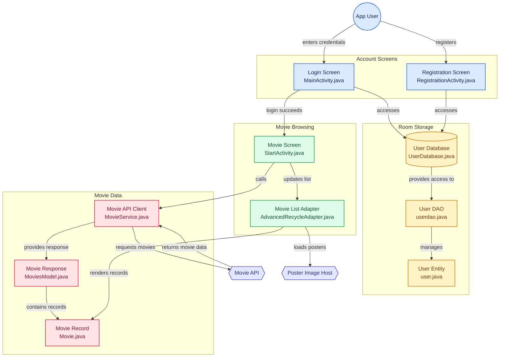

# 1= Sign-Up-System
## Using ROOM Database
### Sign up-Log in system that allows users to create their username and password and then use them to log in to the Application :

 
<h3 >if Username or password is worng </h3>

 
 <h3>User Can register</h3> 

 

 
<h3>Then he can log in to the application</h3>
 

 

 

## Movies Viewer — Project Architecture

